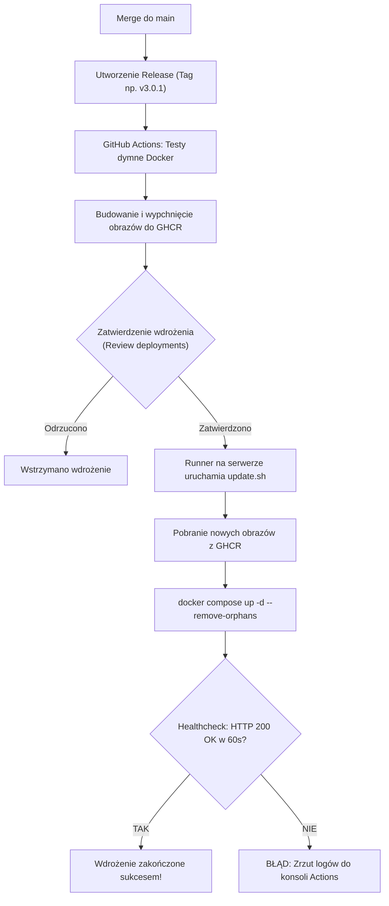

# Przewodnik Przepływu Pracy (Git, CI/CD i Wdrożenia)

> **Dla kogo jest ten dokument:**  
> Ten przewodnik jest skierowany do praktykantów i młodszych programistów dołączających do zespołu Louez. Opisuje krok po kroku pełny cykl życia kodu — od pomysłu i stworzenia gałęzi, przez weryfikację jakości, aż po wydanie i wdrożenie na serwer produkcyjny.
>
> Nawet jeśli znasz polecenia Gita i Dockera z uczelni czy kursów, w projekcie komercyjnym łatwo o wpadkę (np. przypadkowy push na `main`, utratę kodu przy rozwiązywaniu konfliktów czy zepsucie CI). Ten dokument nauczy Cię dobrych nawyków i pokaże, jak radzić sobie z problemami bez stresu.

---

## Spis Treści

1. [Złote Zasady (Primum non nocere)](#1-złote-zasady)
2. [Krok 1: Start nowego zadania (Tworzenie gałęzi)](#2-krok-1-start-nowego-zadania)
3. [Krok 2: Praca lokalna i commity](#3-krok-2-praca-lokalna-i-commity)
4. [Krok 3: Lokalna weryfikacja przed pushem (Bramki jakości)](#4-krok-3-lokalna-weryfikacja-przed-pushem)
5. [Krok 4: Pull Request i Code Review](#5-krok-4-pull-request-i-code-review)
6. [Praca Równoległa w Zespole (Multi-Developer Workflow)](#6-praca-równoległa-w-zespole-multi-developer-workflow)
7. [Typowe Wpadki i Rozwiązania (FAQ Awaryjne)](#7-typowe-wpadki-i-rozwiązania)
   - [Wpadka A: Przypadkowo zrobiłem zmiany na `main`](#wpadka-a-przypadkowo-zrobiłem-zmiany-na-main)
   - [Wpadka B: Konflikty przy łączeniu (Merge Conflicts)](#wpadka-b-konflikty-przy-łączeniu-merge-conflicts)
   - [Wpadka C: Czerwone CI na GitHubie (TypeScript / Linter)](#wpadka-c-czerwone-ci-na-githubie)
8. [Krok 5: Merge do gałęzi głównej](#8-krok-5-merge-do-gałęzi-głównej)
9. [Krok 6: Wdrożenie na Produkcję (CD & Release)](#9-krok-6-wdrożenie-na-produkcję)
10. [Ściągawka dla Programisty (Quick Reference)](#10-ściągawka-dla-programisty)

---

## 1. Złote Zasady

Zanim wpiszesz jakiekolwiek polecenie w terminalu, zapamiętaj te 4 zasady:

1. **`main` jest święty.**  
   Gałąź `main` odzwierciedla działający, przetestowany kod. **Nigdy nie pracujemy bezpośrednio na `main`** i nigdy nie wypychamy do niego zmian z pominięciem Pull Requesta.
2. **Lokalny komputer sprawdza kod, GitHub Actions go tylko zatwierdza.**  
   Nie traktuj GitHuba jako darmowego lintera. Zanim zrobisz `git push`, musisz uruchomić testy formatowania, lintera i typów u siebie na komputerze.
3. **Nie bój się pytać i nie ukrywaj błędów.**  
   Każdemu zdarza się pomylić gałęzie lub zepsuć rebase. W Git prawie wszystko da się cofnąć i naprawić, o ile nie zaczniesz chaotycznie wpisywać poleceń z flagą `--force`.
4. **Zawsze aktualizuj `main` przed rozpoczęciem pracy.**  
   Rozpoczynanie pracy od nieaktualnego kodu to gwarancja męczących konfliktów przy mergowaniu.

---

## 2. Krok 1: Start nowego zadania

Zawsze zaczynaj od zaktualizowania lokalnego `main` do najświeższego stanu z serwera:

```bash
# 1. Przełącz się na gałąź główną
git checkout main

# 2. Pobierz najnowsze zmiany z GitHuba
git pull origin main

# 3. Utwórz nową gałąź funkcyjną i na nią przejdź
git checkout -b <rodzaj>/<krótki-opis-angielski>
```

### Konwencja nazewnictwa gałęzi:

Nazwa gałęzi powinna mówić, czym jest zmiana:

- `feat/add-reservation-delete-modal` — nowa funkcjonalność dla użytkownika.
- `fix/negotiable-price-display` — naprawa błędu.
- `refactor/clean-customer-dialog-types` — poprawa struktury kodu bez zmiany działania.
- `chore/update-pnpm-lock` — zadania porządkowe, konfiguracja, biblioteki.

---

## 3. Krok 2: Praca lokalna i commity

Gdy piszesz kod, twórz commity regularnie — po ukończeniu małych, logicznych całości. Lepiej mieć 4 małe, czytelne commity niż 1 gigantyczny z opisem _"changes"_.

### Format wiadomości commitów (Conventional Commits):

Stosujemy format: `<typ>(<zakres>): <opis w trybie rozkazującym po angielsku>`

Przykłady:

- `feat(reservations): add confirmation step to delete action`
- `fix(storefront): prevent price flickers on negotiable items`
- `style: auto-fix formatting with oxfmt`
- `fix(lint): remove unused imports in customer-form`

```bash
# Sprawdź, które pliki zmodyfikowałeś
git status

# Zobacz dokładne różnice
git diff

# Dodaj wybrane pliki do commita
git add apps/web/components/dashboard/customer-create-dialog.tsx

# Zacommituj z czytelnym opisem
git commit -m "fix(dashboard): correct CustomerType import in create dialog"
```

---

## 4. Krok 3: Lokalna weryfikacja przed pushem

Nasz monorepo posiada **3 bramki jakości**. Wszystkie trzy muszą przejść bez ani jednego błędu, zanim wypchniesz gałąź na GitHuba:

```bash
# BRAMKA 1: Sprawdzenie formatowania kodu (Oxfmt)
pnpm format:check

# Jeśli formatowanie wyrzuci błąd, napraw je automatycznie jednym poleceniem:
pnpm format

# BRAMKA 2: Linter i audyt duplikatów (Oxlint)
pnpm lint

# BRAMKA 3: Weryfikacja typów TypeScript we wszystkich aplikacjach i pakietach
pnpm type-check
```

> [!TIP]
> Jeśli chcesz sprawdzić wszystko naraz jednym poleceniem, uruchom:
>
> ```bash
> pnpm check
> ```
>
> Jeśli `pnpm check` kończy się kodem `0`, Twój kod jest gotowy do wysłania.

---

## 5. Krok 4: Pull Request i Code Review

### 1. Wypchnięcie kodu na GitHuba

Za pierwszym razem użyj flagi `-u` (`--set-upstream`), aby powiązać lokalną gałąź ze zdalną:

```bash
git push -u origin feat/add-reservation-delete-modal
```

### 2. Otwarcie Pull Requesta (PR)

1. Wejdź na [GitHubie do repozytorium Louez](https://github.com/eNStudios-Rental/Louez).
2. Na samej górze pojawi się żółty pasek: **"Compare & pull request"** — kliknij go.
3. Wypełnij tytuł i opis PR:
   - **Co zostało zrobione:** krótkie podsumowanie wprowadzonych zmian.
   - **Jak to przetestować:** kroki dla testera lub drugiego programisty, aby sprawdzić zachowanie w aplikacji.
4. Upewnij się, że jako gałąź docelową (base branch) wybrano **`main`**.
5. Kliknij **Create pull request**.

### 3. Weryfikacja automatyczna (GitHub Actions CI)

Po utworzeniu PR GitHub uruchamia workflow `.github/workflows/ci.yml`.
Sprawdza on dokładnie te same rzeczy, które uruchamiałeś lokalnie (`format:check`, `lint`, `type-check`).

- Jeśli widzisz **zielony znaczek (All checks have passed)** — świetna robota!
- Jeśli widzisz **czerwony krzyżyk** — kliknij _Details_, przeczytaj błąd i popraw go lokalnie (zobacz sekcję [Typowe Wpadki](#wpadka-c-czerwone-ci-na-githubie)).

---

## 6. Praca Równoległa w Zespole (Multi-Developer Workflow)

W projekcie komercyjnym rzadko pracujesz sam. Zazwyczaj kilku programistów jednocześnie modyfikuje kod w różnych (lub tych samych) gałęziach. Oto jak pracować płynnie w zespole i uniknąć chaosu:

### 1. Równoległa praca na osobnych gałęziach (Feature A i Feature B)

Wyobraź sobie sytuację:

- Ty pracujesz nad `feat/export-pdf-reports`.
- Kolega w tym samym czasie skończył `feat/delete-reservation` i jego kod został połączony z `main`.
- Twój branch w tym momencie stał się **nieaktualny** względem `main`.

**Dobra praktyka:** Regularnie (np. codziennie rano lub po merge'u kolegi) dociągaj świeży `main` do swojej gałęzi:

```bash
git fetch origin
git merge origin/main
```

Dzięki temu ewentualne konflikty rozwiązujesz na bieżąco (gdy różnice są małe), a nie w dniu zgłoszenia PR, gdy zmian na `main` nazbierało się już kilkadziesiąt.

### 2. Wspólna praca dwóch osób na TEJ SAMEJ gałęzi (Pair programming / wspólne zadanie)

Gdy pracujesz z kimś nad tą samą gałęzią `feat/wspolne-zadanie`:

- Kolega zrobił commit i wypchnął go na GitHuba (`git push`).
- Ty lokalnie też napisałeś kod i wpisujesz `git push`.
- Git wyrzuca błąd: `[rejected - non-fast-forward]`.

> [!CAUTION]
> **NIGDY nie używaj `git push --force`!**  
> Użycie `--force` nadpisze i **bezpowrotnie skasuje** commity Twojego kolegi ze zdalnego GitHuba!

**Prawidłowe rozwiązanie:**

```bash
# Pobierz zmiany kolegi i nałóż swoje commity na sam wierzch:
git pull --rebase origin feat/wspolne-zadanie

# Jeśli wystąpią konflikty, rozwiąż je w IDE, a następnie:
git add -A
git rebase --continue

# Dopiero teraz bezpiecznie wypchnij:
git push origin feat/wspolne-zadanie
```

### 3. Konflikty w Bazie Danych (Drizzle ORM / Schemat)

Gdy dwóch programistów jednocześnie modyfikuje bazę danych w `packages/db/src/schema/`:

1. Upewnij się po rozwiązaniu konfliktu w `schema.ts`, że nazwy wszystkich kolumn, tabel i indeksów są spójne.
2. Uruchom `pnpm db:push`, aby upewnić się, że baza przyjmuje zmiany.
3. Przetestuj seedera: `pnpm db:seed:demo`.

### 4. Schowek Gita (`git stash`) — nagła zmiana kontekstu

Częsty scenariusz: pracujesz nad swoim kodem, masz nieskończone zmiany (kod się nie kompiluje), a lider prosi Cię: _"Sprawdź szybko błąd na main lub pomóż koledze na jego branchu"_.

Nie musisz robić brzydkiego commita z opisem _"wip"_. Użyj schowka:

```bash
# 1. Schowaj niezacommitowane zmiany do schowka
git stash

# 2. Twój katalog roboczy jest czysty — możesz przełączyć się na inną gałąź
git checkout main
# ... robisz co potrzebne ...

# 3. Wróć na swoją gałąź i wyciągnij schowane zmiany
git checkout feat/moja-funkcja
git stash pop
```

### 5. Draft Pull Request (WIP) i etykieta Code Review

- **Draft PR:** Jeśli zacząłeś duże zadanie, otwórz PR w trybie **Draft** (w rozwijanym menu przycisku _Create pull request_ wybierz _Create draft pull request_).
  - Informuje to zespół: _"Pracuję nad tym, nie duplikujcie mojej pracy"_.
  - Automatyczne CI w tle sprawdza Twój kod przy każdym pushu.
  - Nikt nie zrobi omyłkowego merge'a niedokończonego kodu.
- **Gotowość do recenzji:** Gdy skończysz i testy będą zielone, kliknij na GitHubie **Ready for review** i przypisz recenzentów (Reviewers).
- **Etykieta komentarzy:** Jeśli recenzent zostawił uwagę:
  - Odpowiedz na komentarz lub popraw kod.
  - **Nie klikaj "Resolve conversation"** bez wyjaśnienia ani poprawki w kodzie. Zostaw zamknięcie wątku recenzentowi, który go zgłosił.

---

## 7. Typowe Wpadki i Rozwiązania

To jest sekcja, do której najczęściej będziesz wracać. Spokojnie — każdy z tych problemów da się rozwiązać w kilka minut.

---

### Wpadka A: Przypadkowo zrobiłem zmiany na `main`

**Objaw:** Napisałeś kod, zrobiłeś commity, po czym wpisujesz `git status` i widzisz: `On branch main`.

#### Sytuacja 1: Jeszcze NIE zrobiłeś `git push` (Twoje commity są tylko lokalnie)

To bardzo proste do naprawienia. Utworzymy nową gałąź z Twoimi zmianami, a `main` cofniemy do stanu z serwera:

```bash
# 1. Utwórz nową gałąź na bazie obecnego stanu (twoje commity przejdą na nią)
git branch feat/moja-funkcja

# 2. Zresetuj lokalną gałąź main do stanu ze zdalnego GitHuba
git reset --hard origin/main

# 3. Przełącz się na nowo utworzoną gałąź funkcyjną
git checkout feat/moja-funkcja

# Teraz jesteś na właściwej gałęzi ze wszystkimi swoimi commitami!
```

#### Sytuacja 2: Przypadkowo zrobiłeś `git push` na `main`

Nigdy nie używaj `git push --force` na gałęzi `main`, bo możesz skasować pracę innych osób z zespołu!
Zamiast tego:

1. Zgłoś to od razu swojemu mentorowi / tech leadowi.
2. Jeśli zmiany na `main` były poprawne, utwórz branch od aktualnego `main`, a na przyszłość upewnij się, że pracujesz na gałęzi funkcyjnej.

---

### Wpadka B: Konflikty przy łączeniu (Merge Conflicts)

**Objaw:** W Twoim PR na GitHubie pojawia się szary komunikat:

> _"This branch has conflicts that must be resolved."_

> [!CAUTION]
> **Nie używaj przycisku "Resolve conflicts" w przeglądarce na GitHubie!**  
> Edytor webowy nie ma sprawdzania TypeScriptu ani formatowania. Kliknięcie _"Accept incoming"_ może przypadkowo wyciąć kod Twojego kolegi z zespołu lub pozostawić kod, który nie przejdzie kompilacji!

#### Jak rozwiązać konflikt poprawnie (Lokalnie w terminalu):

```bash
# 1. Upewnij się, że jesteś na swojej gałęzi funkcyjnej
git checkout feat/moja-funkcja

# 2. Pobierz najświeższy stan main z GitHuba
git fetch origin

# 3. Włącz zmiany z main do swojej gałęzi
git merge origin/main
```

Git poinformuje Cię, w których plikach wystąpił konflikt (zobaczysz `CONFLICT (content): Merge conflict in ...`).

4. Otwórz projekt w VS Code / swoim IDE:
   - Pliki z konfliktami będą oznaczone na czerwono.
   - Zobaczysz znaczniki:
     ```typescript
     <<<<<<< HEAD (Twoje zmiany z tej gałęzi)
     const customerName = `${customer.firstName} ${customer.lastName}`;
     =======
     const customerName = [customer.firstName, customer.lastName].filter(Boolean).join(" ");
     >>>>>>> origin/main (Zmiany z gałęzi głównej)
     ```
5. Przeanalizuj obie wersje:
   - Zazwyczaj celem jest **połączenie obu logik**, a nie bezmyślne usunięcie jednej z nich.
   - Usuń znaczniki `<<<<<<<`, `=======` i `>>>>>>>`.
6. **Kluczowy krok:** Uruchom lokalne testy:
   ```bash
   pnpm format
   pnpm lint
   pnpm type-check
   ```
7. Zacommituj rozwiązany konflikt i wypchnij:
   ```bash
   git add -A
   git commit -m "chore: resolve merge conflicts with main"
   git push origin feat/moja-funkcja
   ```

Twój PR na GitHubie automatycznie zaktualizuje się i konflikt zniknie.

---

### Wpadka C: Czerwone CI na GitHubie

**Objaw:** W PR na GitHubie krok `validate` zakończył się błędem `Process completed with exit code 1`.

#### Jak to zdiagnozować:

1. Kliknij czerwony odnośnik **Details** obok nieudanego testu.
2. Rozwiń krok, który świeci na czerwono (np. `Run TypeScript type-check` lub `Run linter`).
3. Zobacz dokładną treść błędu.

#### Najczęstsze przyczyny:

1. **`error TS2304: Cannot find name 'XYZ'`**  
   Zapomniałeś zaimportować typu lub komponentu (np. `CustomerType`).
2. **`error TS2322: Type 'null' is not assignable to type 'undefined'`**  
   W TypeScript `null` i `undefined` to dwa różne typy. Użyj `?? undefined` lub popraw interfejs.
3. **`error TS1117: An object literal cannot have multiple properties with the same name`**  
   Klucz w obiekcie został zdefiniowany dwukrotnie (częsta pomyłka po merge konfliktów).
4. **`Format issues found`**  
   Zapomniałeś uruchomić `pnpm format` przed commitem. Uruchom `pnpm format`, zrób commit i wypchnij.

---

## 8. Krok 5: Merge do gałęzi głównej

Gdy spełnione są 3 warunki:

1. Wszystkie testy automatyczne w CI świecą na **zielono**.
2. Otrzymałeś zatwierdzenie (Approval) od mentora lub drugiego programisty.
3. Nie ma nierozwiązanych wątków dyskusji w zakładce _Files changed_.

Możesz połączyć kod z `main`. W GitHubie kliknij zielony przycisk **Merge pull request** (lub _Squash and merge_ zgodnie z ustaleniami zespołu), a następnie kliknij **Delete branch**, aby zachować porządek w repozytorium.

Po zmergowaniu, usuń starą gałąź u siebie na komputerze:

```bash
git checkout main
git pull origin main
git branch -d feat/moja-funkcja
```

---

## 9. Krok 6: Wdrożenie na Produkcję

### Dlaczego sam merge do `main` nie wdraża od razu na serwer?

W środowisku produkcyjnym nie chcemy, aby każdy pojedynczy merge automatycznie restartował aplikację u klientów. Wdrożenia są **świadome i kontrolowane**:

- Wdrażamy paczki zmian w postaci **Wydania (Release / Tag)**.
- Każde wdrożenie na serwer wymaga **ręcznego zatwierdzenia przez wyznaczoną osobę (Required Reviewer)**.

---

### Jak wygląda proces wdrożenia krok po kroku:



---

### Jak wydać nową wersję (Tworzenie Release):

1. **Ustal numer wersji według reguł Semantic Versioning (`vMAJOR.MINOR.PATCH`):**
   - **PATCH** (np. `v3.0.1` -> `v3.0.2`): drobne poprawki błędów (bugfixes), małe korekty stylów.
   - **MINOR** (np. `v3.0.2` -> `v3.1.0`): nowa funkcjonalność dla użytkownika wstecznie kompatybilna (np. nowy moduł, nowa integracja).
   - **MAJOR** (np. `v3.1.0` -> `v4.0.0`): duże przełomowe zmiany architektoniczne, zerwanie wstecznej kompatybilności.

2. **Na GitHubie:**
   - Przejdź do zakładki **Releases** (prawa kolumna na stronie głównej repozytorium).
   - Kliknij **Draft a new release**.
   - Kliknij pole **Choose a tag**, wpisz numer wersji (np. `v3.0.1`) i kliknij **Create new tag on publish**.
   - Jako gałąź docelową upewnij się, że wybrano **`main`**.
   - Wpisz tytuł wydania i opisz najważniejsze zmiany.
   - Kliknij **Publish release**.

---

### Gdzie zatwierdzić wdrożenie (Approval):

1. Po opublikowaniu Release przejdź do zakładki **Actions** w GitHubie.
2. Zobaczysz uruchomiony workflow **"Build & Publish Docker Images"**.
3. Gdy zakończą się kroki `smoke-test` i `build`, workflow zatrzyma się na kroku **Deploy to Production** z żółtym powiadomieniem:
   > **`production` is waiting for review**
4. Kliknij przycisk **Review deployments**.
5. Zaznacz pole przy środowisku `production` i kliknij zielony przycisk **Approve and deploy**.

---

### Co dzieje się pod maską na serwerze:

1. **Natywny GitHub Runner:**
   Na serwerze działa usługa systemowa `actions-runner`, która nasłuchuje zadań z GitHuba.
2. **Autoryzacja w GHCR:**
   Runner loguje się do rejestru `ghcr.io` za pomocą tymczasowego tokena `GITHUB_TOKEN`.
3. **Synchronizacja konfiguracji:**
   Runner pobiera najnowsze wersje plików `docker-compose.yml`, `Caddyfile` oraz `update.sh` i nadpisuje je w katalogu `/opt/louez/`.
4. **Wykonanie wdrożenia ([`update.sh`](file:///home/mpolak/Projects/Louez/update.sh)):**
   - Skrypt ustawia `LOUEZ_IMAGE_TAG` na wdrożoną wersję.
   - Pobiera nowe obrazy: `docker compose pull louez background-removal`.
   - Przeładowuje kontenery bez przestoju: `docker compose up -d --remove-orphans`.
   - **Weryfikacja Healthcheck:** przez 60 sekund odpytuje endpoint `http://localhost:3000/api/health`. Dopiero gdy aplikacja zwróci kod HTTP 200, wdrożenie zostaje uznane za udane.
   - Czyści stare warstwy obrazów: `docker image prune -f`.
   - Jeśli aplikacja nie wstanie w ciągu 60s, skrypt zrzuca logi kontenera prosto do podglądu w GitHub Actions i przerywa działanie.

---

## 10. Ściągawka dla Programisty (Quick Reference)

| Co chcesz zrobić?                             | Polecenie w terminalu                                   |
| :-------------------------------------------- | :------------------------------------------------------ |
| **Rozpocząć nowy dzień pracy**                | `git checkout main && git pull origin main`             |
| **Stworzyć nową gałąź**                       | `git checkout -b feat/nazwa-funkcji`                    |
| **Sprawdzić zmienione pliki**                 | `git status -s`                                         |
| **Sprawdzić dokładne zmiany w kodzie**        | `git diff`                                              |
| **Dodać pliki i zrobić commit**               | `git add -A && git commit -m "feat(scope): message"`    |
| **Automatycznie sformatować kod**             | `pnpm format`                                           |
| **Uruchomić linter**                          | `pnpm lint`                                             |
| **Sprawdzić typy TypeScript**                 | `pnpm type-check`                                       |
| **Sprawdzić wszystkie bramki jakości naraz**  | `pnpm check`                                            |
| **Wypchnąć gałąź na GitHuba po raz pierwszy** | `git push -u origin feat/nazwa-funkcji`                 |
| **Pobrać zmiany z main do swojej gałęzi**     | `git fetch origin && git merge origin/main`             |
| **Usunąć lokalną gałąź po zmergowaniu**       | `git checkout main && git branch -d feat/nazwa-funkcji` |
